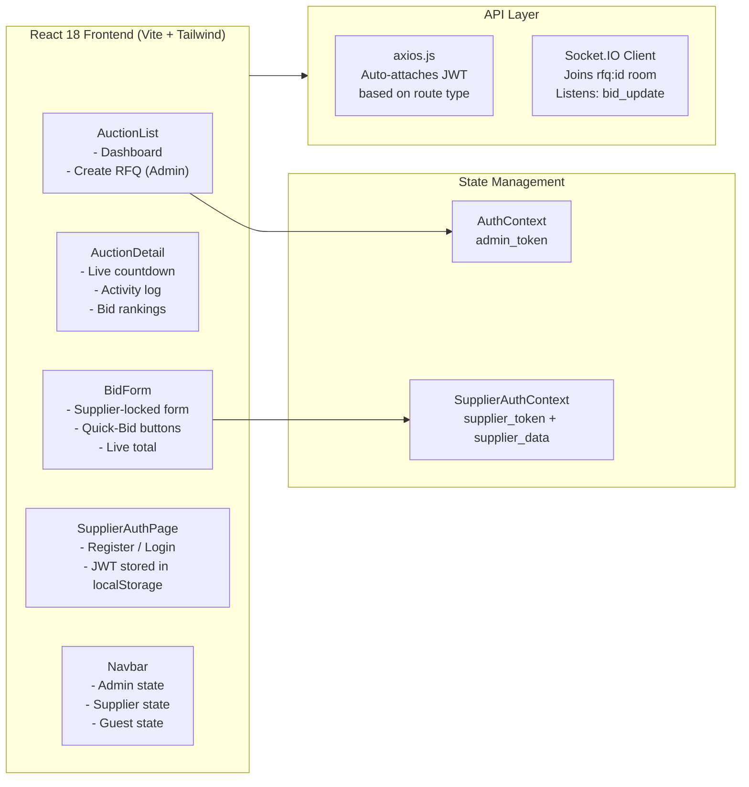
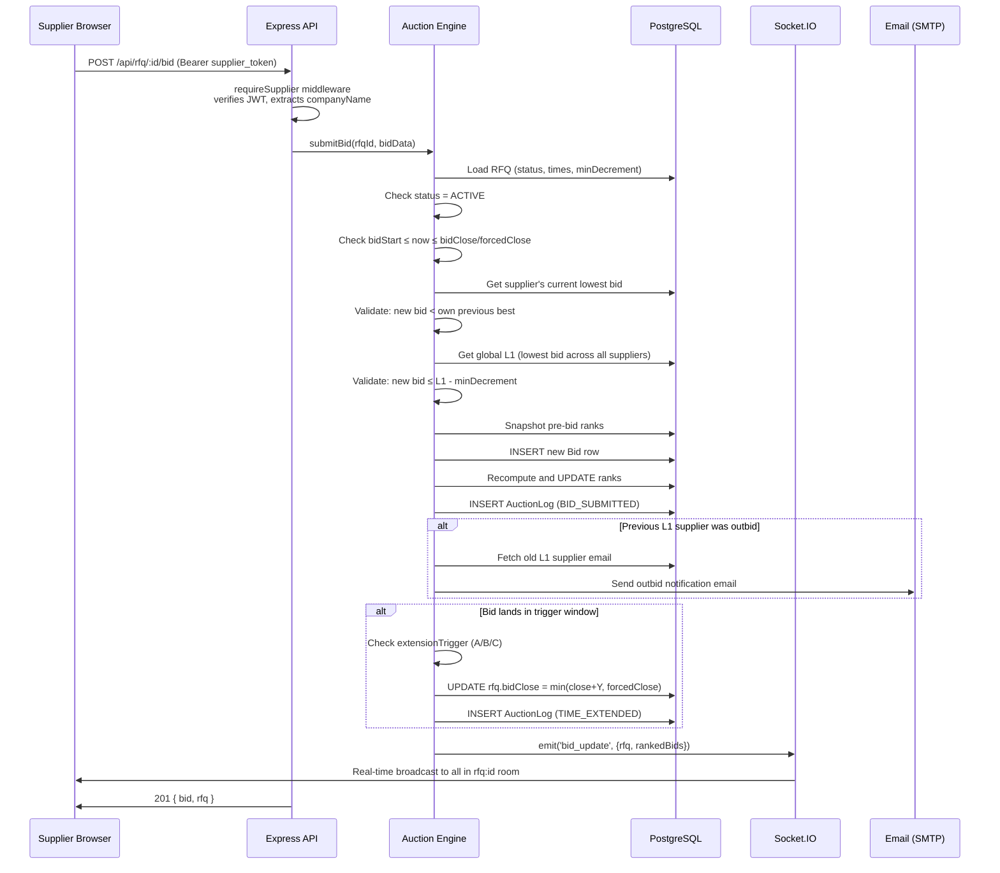
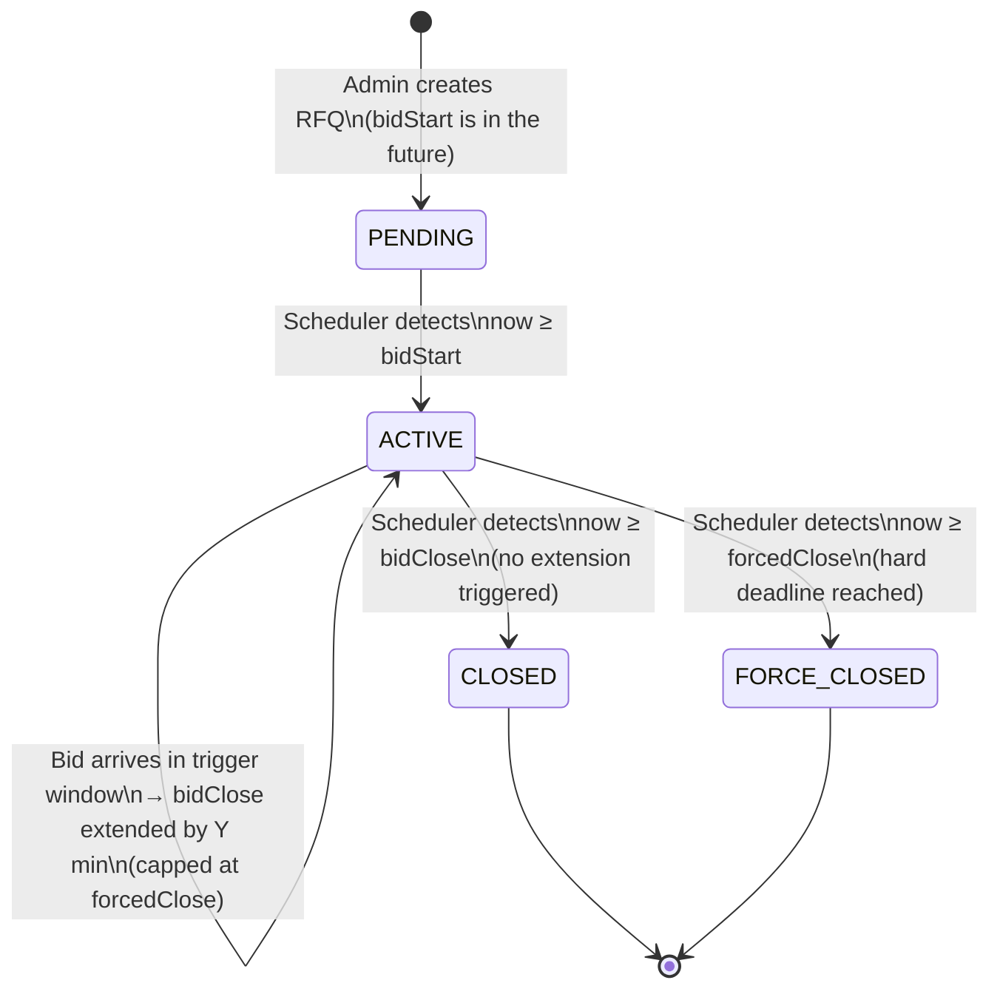
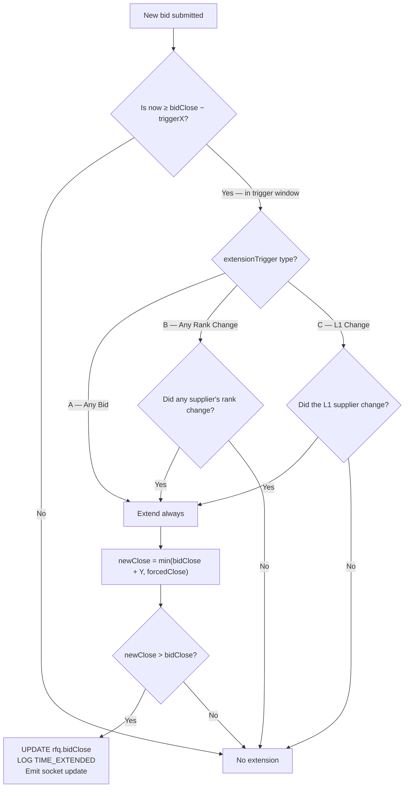
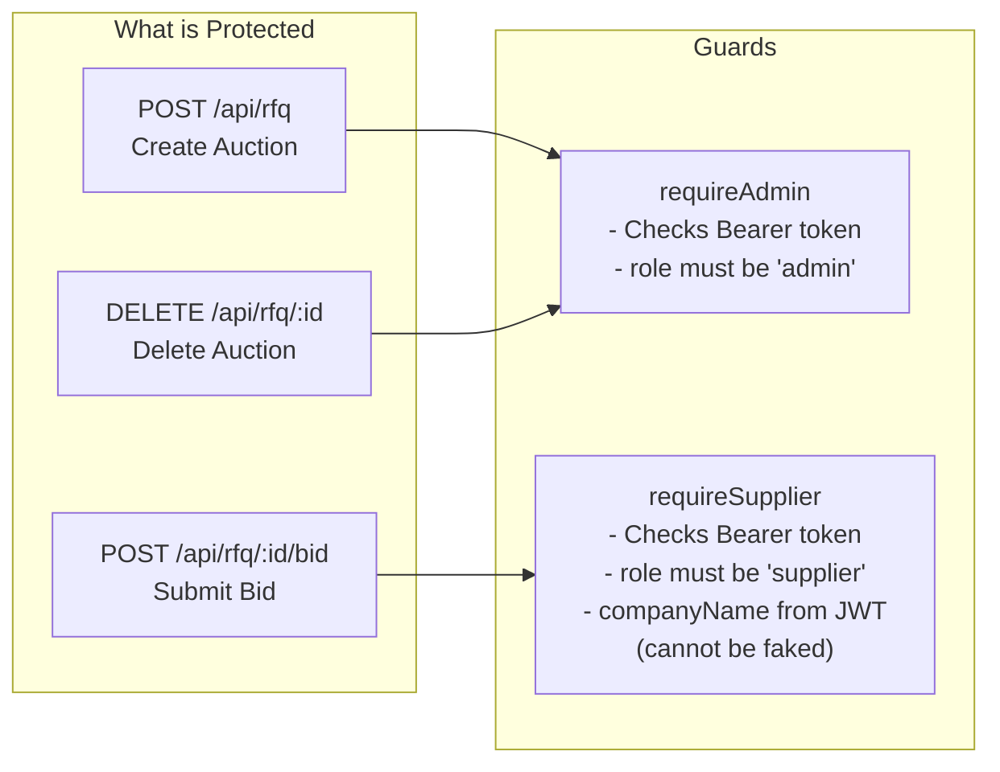

# High-Level Design — British Auction RFQ System

## 1. System Overview

A **real-time reverse auction platform** for logistics procurement. The buyer (Admin) creates freight RFQs and multiple logistics suppliers compete by bidding the **lowest total freight quote**. The system auto-extends auction time when bids arrive near closing (British Auction rule), ensuring a fair price discovery process.

---

## 2. Architecture Diagram

```mermaid
flowchart TD
    A["&#x1F4BB; Admin Browser"] -->|"HTTP REST (admin_token JWT)"| E
    B["&#x1F69B; Supplier Browser"] -->|"HTTP REST (supplier_token JWT)"| E
    B -->|"Socket.IO (real-time)"| E
    C["&#x1F453; Guest Browser"] -->|"View Only (no auth)"| E

    subgraph Backend ["&#x2699;&#xFE0F; Express.js Backend (Node.js + Socket.IO)"]
        E["API Gateway\n/api/auth\n/api/rfq\n/api/supplier"]
        F["&#x1F510; Auth Middleware\nrequireAdmin / requireSupplier\n(JWT verification)"]
        G["&#x26A1; Auction Engine\nauctionEngine.js\n- Bid validation\n- Rank computation\n- Trigger A/B/C\n- Time extension"]
        H["&#x23F0; Scheduler\nnode-cron (every 10s)\nPENDING→ACTIVE\nACTIVE→CLOSED"]
        I["&#x1F4E7; Email Service\nnodemailer + Gmail SMTP\nOutbid notifications"]
    end

    subgraph DB ["&#x1F5C4;&#xFE0F; Neon PostgreSQL (Cloud)"]
        J[("RFQ")]
        K[("Supplier")]
        L[("Bid")]
        M[("AuctionLog")]
    end

    E --> F --> G
    G -->|"db read/write"| L
    G -->|"log events"| M
    G -->|"emit bid_update"| B
    G -->|"send outbid email"| I
    H -->|"status updates"| J
    E -->|"Prisma ORM"| DB
```

---

## 3. Component Breakdown

---

## 4. Bid Submission Flow

---

## 5. Auction Lifecycle (State Machine)

---

## 6. Extension Trigger Logic

---

## 7. Security Architecture

---

## 8. Tech Stack

| Layer | Technology |
|---|---|
| **Frontend** | React 18, Vite, Tailwind CSS, Zustand, React Router v6, Socket.IO Client |
| **Backend** | Node.js, Express 5, Socket.IO, node-cron |
| **Auth** | JSON Web Tokens (jsonwebtoken), bcryptjs |
| **Validation** | Zod |
| **ORM** | Prisma 7 (`@prisma/adapter-pg`) |
| **Database** | PostgreSQL (Neon serverless cloud) |
| **Email** | Nodemailer + Gmail SMTP |
| **HTTP Client** | Axios (with JWT interceptor) |
