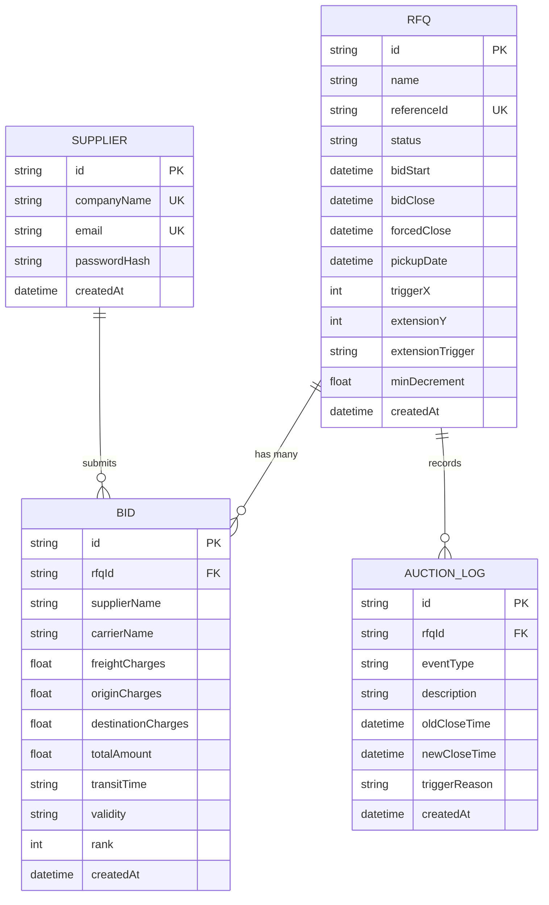
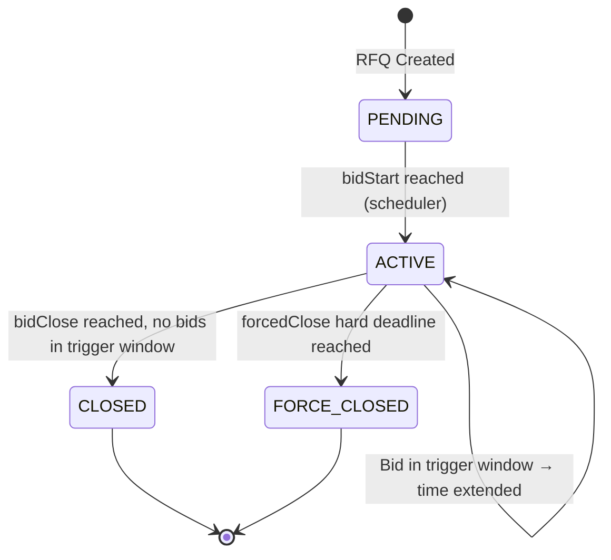

# Database Schema — British Auction RFQ System

---

## Table Details

### RFQ
The core auction entity created by the Admin.

| Column | Type | Notes |
|---|---|---|
| `id` | `string` | UUID, Primary Key |
| `name` | `string` | Auction title / item description |
| `referenceId` | `string` | Unique internal reference number |
| `status` | `string` | `PENDING` → `ACTIVE` → `CLOSED` / `FORCE_CLOSED` |
| `bidStart` | `datetime` | When bidding opens |
| `bidClose` | `datetime` | Soft closing time (can be extended) |
| `forcedClose` | `datetime` | Hard deadline — no extension beyond this |
| `pickupDate` | `datetime` | Cargo pickup date |
| `triggerX` | `int` | Trigger window in minutes before `bidClose` |
| `extensionY` | `int` | Extension duration in minutes per trigger |
| `extensionTrigger` | `string` | `A` = any bid · `B` = rank change · `C` = L1 change |
| `minDecrement` | `float` | Minimum ₹ drop required below current L1 |
| `createdAt` | `datetime` | Auto-set |

---

### Supplier
Registered logistics vendors who can bid.

| Column | Type | Notes |
|---|---|---|
| `id` | `string` | UUID, Primary Key |
| `companyName` | `string` | Unique — used as bid identity |
| `email` | `string` | Unique — used for login & outbid notifications |
| `passwordHash` | `string` | bcrypt hash (cost 10) |
| `createdAt` | `datetime` | Auto-set |

---

### Bid
One row per bid submission. A supplier can submit multiple bids (each must be lower than their own previous best).

| Column | Type | Notes |
|---|---|---|
| `id` | `string` | UUID, Primary Key |
| `rfqId` | `string` | FK → RFQ |
| `supplierName` | `string` | Copied from Supplier JWT — cannot be faked |
| `carrierName` | `string` | Truck / vehicle name |
| `freightCharges` | `float` | Base freight cost |
| `originCharges` | `float` | Pickup / loading charges |
| `destinationCharges` | `float` | Delivery / unloading charges |
| `totalAmount` | `float` | Sum computed on server — never trusted from client |
| `transitTime` | `string` | Estimated delivery time |
| `validity` | `string` | Quote validity period |
| `rank` | `int` | Current rank (1 = L1 / winning) |
| `createdAt` | `datetime` | Auto-set |

---

### AuctionLog
Immutable audit trail of all events in an auction.

| Column | Type | Notes |
|---|---|---|
| `id` | `string` | UUID, Primary Key |
| `rfqId` | `string` | FK → RFQ |
| `eventType` | `string` | `BID_SUBMITTED` · `TIME_EXTENDED` · `AUCTION_CLOSED` etc. |
| `description` | `string` | Human-readable event description |
| `oldCloseTime` | `datetime` | Previous close time (for extension events) |
| `newCloseTime` | `datetime` | New close time after extension |
| `triggerReason` | `string` | Which trigger caused the extension (`A` / `B` / `C`) |
| `createdAt` | `datetime` | Auto-set |

---

## Status Flow

